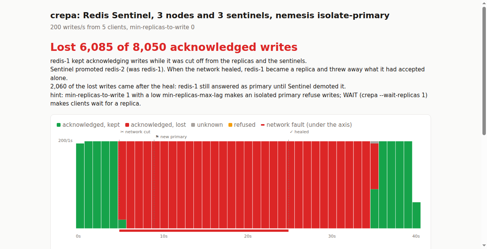

# crepa

[](https://github.com/AndreaAcanfora/crepa/actions/workflows/ci.yml)

**Cut the network inside your docker compose. See which acknowledged writes your database throws away.**

Your Redis answered `OK`. Then the network between two containers dropped for a few
seconds, Sentinel promoted a replica, and when the network came back the write was gone.
No error, no log line, nothing for the client to notice.

[Jepsen](https://jepsen.io) has shown this kind of loss in database after database for
over ten years. Running Jepsen means Clojure, a control node, a handful of machines to SSH into and an
afternoon of setup. crepa does the core of it in one command, against the compose file
you already have:

```
$ crepa redis -f examples/redis-sentinel/compose.yaml
       · starting compose project crepa-redis-sentinel from examples/redis-sentinel/compose.yaml
       · nodes: redis-1, redis-2, redis-3; sentinels: sentinel-1, sentinel-2, sentinel-3
       · attaching network helpers
       · waiting for master "mymaster" to be healthy
  0.0s  primary is redis-1; writing 200/s from 5 clients
  5.2s  ✂ isolated redis-1 (the primary) from redis-2, redis-3, sentinel-1, sentinel-2, sentinel-3
  9.3s  ⚑ Sentinel promoted redis-2 (was redis-1)
 25.3s  ✓ network healed
 40.3s  stopped writing; waiting for the nodes to agree
 40.3s  read 1,965 values back from redis-2

timeline (1 column = 1s)
           0s        10s       20s       30s       40s
  fault         ▓▓▓▓▓▓▓▓▓▓▓▓▓▓▓▓▓▓▓▓
  acked    ▇██████████████████████████████████▇████▃
  lost          ▇█████████████████████████████▄
  errors                                      ·
  acked by 11111111111111111111111111111111111122222
           1=redis-1  2=redis-2  3=redis-3

✗ LOST 6,085 of 8,050 acknowledged writes (75.6%)
  6,085 acknowledged by redis-1
  4,025 were written during the fault
  redis-1 kept acknowledging writes while it was cut off from the replicas and the sentinels.
  Sentinel promoted redis-2 (was redis-1). When the network healed, redis-1 became a replica and threw away what it had accepted alone.
  2,060 of the lost writes came after the heal: redis-1 still answered as primary until Sentinel demoted it.
  hint: min-replicas-to-write 1 with a low min-replicas-max-lag makes an isolated primary refuse writes; WAIT (crepa --wait-replicas 1) makes clients wait for a replica.
  first lost write #1016 at 5.1s, last #7100 at 35.5s
  writes: 8,055 attempted, 8,050 acknowledged, 0 refused, 5 unknown (0 of them made it)

report: crepa-report.html
```

Three Redis nodes, three Sentinels, stock Redis 7.4 settings and a 20-second partition.
Three writes out of four that Redis confirmed are gone. A quarter of the loss came
*after* the network was already back. That is a real run, and CI repeats it on every
commit.

The HTML report of the same run (`--report`):



## The same partition, three configurations

Every row is a CI run of [`examples/redis-sentinel`](examples/redis-sentinel): the
primary is cut off from everything else for 20 seconds while 5 clients write 200 values
a second.

| configuration | acknowledged | lost | what happened |
|---|---:|---:|---|
| default | 8,050 | **6,085** | the isolated primary accepts writes during the partition and for about 10 s after it |
| `min-replicas-to-write 1`, `min-replicas-max-lag 5` | 8,055 | **1,115** | the isolated primary accepts writes until the 5 s lag runs out, then refuses them |
| default + `WAIT 1` after each write (`--wait-replicas 1`) | 7,050 | **0** | writes on the isolated primary time out instead of being confirmed; about 4 s with no successful writes |
| no fault (`--nemesis none`) | 8,000 | 0 | control run |

`min-replicas-to-write` is what the Redis docs suggest for this. It shrinks the loss but
does not remove it. `WAIT` lost nothing here, but Redis does not promise that it never
will: crepa tells you what happened in your setup, not what can't happen.

## What crepa does

1. Starts your compose file as its own project (`crepa-<directory>`), so it never
   touches a stack you are already running. Volumes are removed before and after.
2. Starts a small helper container in the network namespace of every Redis and
   Sentinel container. The helpers hold iptables rules. Your images need no tools and
   no extra privileges.
3. Waits until Sentinel agrees on a primary and every replica is connected.
4. Runs clients that behave like a Sentinel-aware client library: ask Sentinel for the
   primary, stay on that connection until it fails, ask again. Each client adds unique
   numbers to a set and records whether the server confirmed, refused, or never
   answered.
5. Cuts the network (`--nemesis`), keeps it cut for `--fault`, heals it, and keeps
   writing for `--recover`.
6. Waits until the nodes agree again, reads the set back from the new primary and from
   every replica, and compares it with what the clients were told.

A write is **lost** when the server confirmed it and it is not there at the end. Writes
that timed out are **unknown**: they may or may not be there, and crepa counts both
outcomes without blaming anyone. A write the server refused but that shows up anyway is
reported too.

The exit status is 0 when no acknowledged write was lost, 1 when some were, and 2 on
errors, so you can put crepa in CI.

## Install

```
go install github.com/AndreaAcanfora/crepa/cmd/crepa@latest
```

crepa needs the `docker` CLI with compose v2, and a Linux host. It connects to the
containers by their IP addresses, which Docker Desktop on macOS and Windows does not
route to the host. The containers' kernel needs iptables (nf_tables), which every
current Docker host has.

## Usage

```
crepa redis [flags]
```

With no `-f`, crepa uses `compose.yaml` or `docker-compose.yml` in the current
directory. It recognizes Redis and Valkey nodes and Sentinels by image and command. If
your services look different, use `--nodes` and `--sentinels`.

| flag | default | |
|---|---|---|
| `-f` | compose.yaml | compose file, repeatable for overrides |
| `--nemesis` | `isolate-primary` | `isolate-primary`, `halves` (random split of all nodes and sentinels) or `none` |
| `--warmup` | 10s | healthy writing before the first fault |
| `--fault` | 20s | how long each fault lasts |
| `--recover` | 20s | healthy writing after each heal |
| `--cycles` | 1 | fault and recover cycles |
| `--clients` | 5 | concurrent clients |
| `--rate` | 200 | writes per second, all clients together |
| `--timeout` | 1s | timeout of each write |
| `--wait-replicas` | 0 | `WAIT` for this many replicas before counting a write as acknowledged |
| `--report` | crepa-report.html | HTML report with the timeline; empty for none |
| `--keep` | false | leave the project running at the end |
| `--no-up` | false | use the project as it is running now (pass `--project` with its name) |

The HTML report has the same timeline as the terminal, one bar per second split into
kept, lost, unknown and refused writes, with the fault and the failover marked on it.

## Why "crepa"

It is Italian for *crack*: the thin break in a wall you don't see until something falls
through it.

## Roadmap

- More workloads with their own failover: Postgres with Patroni, MongoDB replica sets,
  etcd, Kafka, RabbitMQ quorum queues.
- More faults: one-way partitions, packet loss and latency, clock skew, paused
  containers.
- Running the clients inside the compose network, so Docker Desktop works too.

## License

MIT
